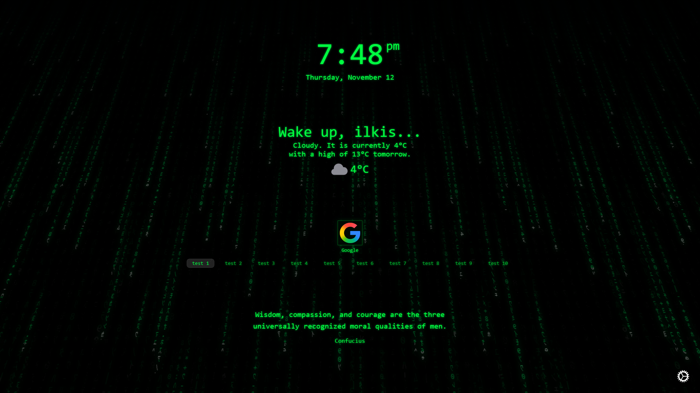
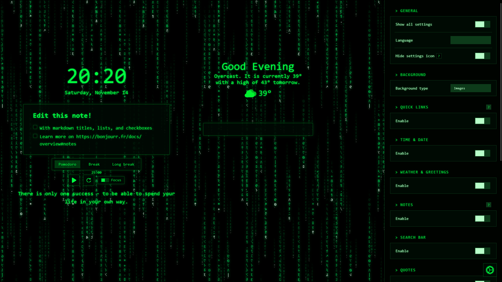

# Matrix snippets for Bonjourr

Pure-CSS "digital rain" backgrounds and green-terminal UI styling for the
[Bonjourr](https://bonjourr.fr) new tab extension. No JavaScript: paste a
snippet into Settings → Custom CSS.



## Rain backgrounds

Paste one of these whole. Each has variables at the top:
`--mx-color`, `--mx-size`, `--mx-speed`, `--mx-glow`.

| Snippet | What the code does | Screenshot |
|---|---|---|
| [`matrix-katakana.css`](css/matrix-katakana.css) | green mirrored katakana, one layer pair | [view](screenshots/matrix-katakana.png) |
| [`matrix-binary.css`](css/matrix-binary.css) | only `0` and `1`, small and fast, blue | [view](screenshots/matrix-binary.png) |
| [`matrix-crt.css`](css/matrix-crt.css) | code symbols in amber, CRT scanlines, vignette | [view](screenshots/matrix-crt.png) |
| [`matrix-depth.css`](css/matrix-depth.css) | three depth layers, blurred back layers, slow drift | [view](screenshots/matrix-depth.png) |
| [`matrix-glitch.css`](css/matrix-glitch.css) | fast red katakana with scripted glitches | [view](screenshots/matrix-glitch.png) |
| [`matrix-spectrum.css`](css/matrix-spectrum.css) | colour changes across the screen (`--mx-colors`) | [view](screenshots/matrix-spectrum.png) |
| [`matrix-hex.css`](css/matrix-hex.css) | hex digits `0–9 A–F`, violet | [view](screenshots/matrix-hex.png) |
| [`matrix-tilt.css`](css/matrix-tilt.css) | the rain plane leans in perspective (`--mx-tilt`) | [view](screenshots/matrix-tilt.png) |
| [`matrix-upward.css`](css/matrix-upward.css) | gold rain that flows upwards | [view](screenshots/matrix-upward.png) |
| [`matrix-neon.css`](css/matrix-neon.css) | yellow rain over cyan (`--mx-back`), sliced bands, colour-split bursts | [view](screenshots/matrix-neon.png) |
| [`matrix-operator.css`](css/matrix-operator.css) | dense flat grid, cells light up in place, no rain | [view](screenshots/matrix-operator.png) |

The picture at the top is Tilt with `matrix-ui-text.css` and the
recommended settings below; the screenshots in the table show Bonjourr with
default settings.

## Recommended settings

For better readability of the new tab page, I recommend these Bonjourr
settings under Settings → Background:

| Setting | Value |
|---|---|
| Background type | Solid color |
| Background color | `#000000` |
| Texture overlay | Grain |

With a texture overlay on, the brightest rain layer takes the texture's
opacity and becomes dimmer, so the clock, greeting and links stand out.

## SVG backgrounds

The same eleven rains as animated SVG files, used as a regular Bonjourr
background by link. They take no room in Custom CSS, so all four UI
snippets fit next to them, and Bonjourr's own blur, brightness and texture
settings apply to them.

1. Settings → Background → Background type: **URLs**.
2. Paste one link into **Background URLs** and press **Apply changes**:

```
https://ilkis.github.io/bonjourr-matrix-css/svg/fhd/matrix-katakana.svg
```

The link is `…/svg/<set>/<name>.svg`. Pick the set for your screen:

| Set | Made for | Folder |
|---|---|---|
| `fhd` | 1920×1080 | [`svg/fhd`](svg/fhd) |
| `2k` | 2560×1440 | [`svg/2k`](svg/2k) |
| `4k` | 3840×2160 | [`svg/4k`](svg/4k) |

The names match the CSS snippets: `matrix-katakana`, `matrix-binary`,
`matrix-crt`, `matrix-depth`, `matrix-glitch`, `matrix-spectrum`,
`matrix-hex`, `matrix-tilt`, `matrix-upward`, `matrix-neon`,
`matrix-operator`.

A file holds a fixed number of glyphs and is stretched to cover the screen.
A set made for a smaller screen still works on a larger one, with larger
glyphs; a set made for a larger screen gives smaller glyphs.

Differences from the CSS snippets:

- No variables. Colour, size and speed are fixed in the file; to change
  them, download the file, edit it and host your copy.
- Do not enable a rain CSS snippet at the same time: it replaces the
  background, the SVG included.
- Depth and Tilt are the heaviest files. Tilt in Firefox gets slower as
  the screen gets larger.

## Terminal-style UI

Small independent snippets; they work with any background.
The colour is `--mx-ui`, written as `R G B`.



| Snippet | Styles |
|---|---|
| [`matrix-ui-text.css`](css/matrix-ui-text.css) | clock, greeting, weather, quotes |
| [`matrix-ui-widgets.css`](css/matrix-ui-widgets.css) | search bar, notes, Pomodoro, quick-link tiles |
| [`matrix-ui-settings.css`](css/matrix-ui-settings.css) | settings panel |
| [`matrix-ui-menus.css`](css/matrix-ui-menus.css) | context menu, layout dialog, settings button |

## Size limits

Bonjourr cuts Custom CSS at 8080 characters, and Chrome allows 8192 bytes
per synced setting. Every snippet fits on its own. What fits next to a rain
snippet:

| Rain snippet | Room for one of |
|---|---|
| Katakana, Binary, CRT, Hex, Upward, Operator | widgets, settings, or text + menus |
| Spectrum, Tilt | text or menus |
| Depth, Glitch, Neon | text |

All four UI snippets together fit when no rain snippet is used.

## Known limits

- The pattern loops and repeats; glyphs do not change at random.
- A rain snippet replaces the regular background while enabled.
- Katakana comes from system fonts; without Japanese fonts use Binary, CRT or Hex.
- The glow (`filter: drop-shadow`) is the expensive part; remove that line on slow machines.
- Site icons, the weather icon and the settings gear keep their own colours.
- Spectrum tints white rain with a blended overlay, so `--mx-color` must stay white.
- Operator is dense; the default clock and greeting are harder to read over it.

## Tested

Bonjourr 22.3.0 in Chromium, Firefox 160 and WebKit 26.0 (the Playwright
build on Linux). Not tested in Safari itself.

| Snippet | Chromium | Firefox 160 | WebKit 26.0 |
|---|---|---|---|
| `matrix-katakana.css` | yes | yes | yes |
| `matrix-binary.css` | yes | yes | yes |
| `matrix-crt.css` | yes | yes | yes |
| `matrix-depth.css` | yes | yes | yes |
| `matrix-glitch.css` | yes | yes | yes |
| `matrix-spectrum.css` | yes | yes | yes |
| `matrix-hex.css` | yes | yes | yes |
| `matrix-tilt.css` | yes | yes | not testable |
| `matrix-upward.css` | yes | yes | yes |
| `matrix-neon.css` | yes | yes | yes |
| `matrix-operator.css` | yes | yes | yes |
| `matrix-ui-text.css` | yes | yes | yes |
| `matrix-ui-widgets.css` | yes | yes | yes |
| `matrix-ui-settings.css` | yes | yes | yes |
| `matrix-ui-menus.css` | yes | yes | yes |

"Yes" means the snippet was applied, the animation ran (two frames taken
one after another differed) and the screenshot looked as intended. For the
UI snippets it means the styles were applied to the panels.

- Tilt: that WebKit build draws CSS perspective without depth, on any page,
  so Tilt could not be checked there.
- Glitch and Neon: the glitch frames last a fraction of a second. Neon's
  colour split was seen in Chromium only; Glitch's frames were not caught in
  any browser. The rain itself was checked in all three.

### SVG backgrounds

All eleven files of each set were opened as a page background styled like
Bonjourr's own, in Chromium 141, Firefox 142 and WebKit 26.0 (Playwright
builds on Linux, no GPU), each set on a screen of its own size. Every file
animated in all three browsers. Katakana was also checked inside Bonjourr
as a URL background.

- Tilt: the perspective shows in Chromium and Firefox; that WebKit build
  draws it flat, as with the CSS snippet.
- Tilt in Firefox was the slowest case: without a GPU it dropped to a few
  frames per second on a 3840×2160 screen.
- Not tested in Safari itself, and not measured with a GPU.

## License

[MIT](LICENSE)
